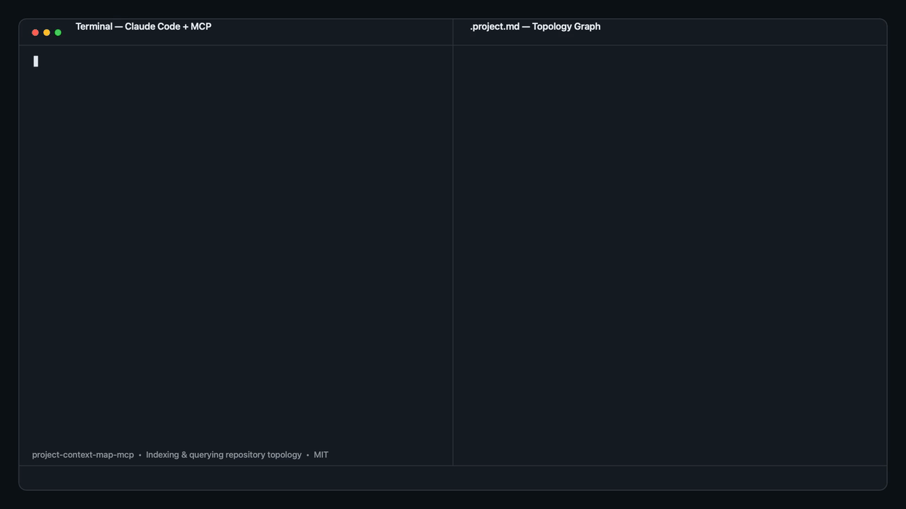
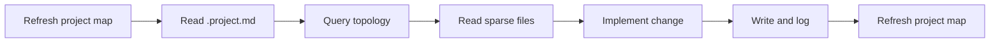

<div align="center">

# Project Context Map MCP

### Give your coding agent a map before it starts wandering

Turn any repository into structured project memory for **Claude Code**, **Cursor**, **VS Code**, and other MCP clients—so agents query dependency topology and git hotspots first, then read only the files that matter.

<p>
  <a href="https://www.npmjs.com/package/project-context-map-mcp"></a>
  <a href="#installation"></a>
  <a href="https://github.com/tamojit-123/project-context-map-mcp/actions/workflows/ci.yml"></a>
  <a href="./LICENSE"></a>
</p>

<p>
  <a href="https://glama.ai/mcp/servers/tamojit-123/project-context-map-mcp"></a>
</p>

<p>
  <a href="https://mcprush.com/to/project-context-map-mcp?ref=badge"></a>
  <a href="https://glama.ai/mcp/servers/tamojit-123/project-context-map-mcp"></a>
</p>

<p>
  <a href="#quick-start">Quick Start</a> ·
  <a href="#why-this-exists">Why This Exists</a> ·
  <a href="#mcp-tools">MCP Tools</a> ·
  <a href="#cli-commands">CLI</a> ·
  <a href="./PROMPTS.md">Prompts</a> ·
  <a href="./CONTRIBUTING.md">Contributing</a>
</p>

<br />



</div>

---

## Why This Exists

AI coding tools often start every session in a medium or large repository by walking directories and opening 15–30 unrelated files—spending tokens before they even understand how modules connect.

`project-context-map-mcp` flips the workflow from `scan everything -> guess -> open random files` to:

> **`index first -> query topology -> read sparse files -> edit with context`**

| Without Project Context Map | With Project Context Map |
| :--- | :--- |
| Scans directories & opens 15–30 unrelated files | Calls `get_project_summary` + `query_topology` first |
| Re-discovers architecture every new session | Reads `.project.md` & `.project-map.json` immediately |
| Misses downstream callers and import chains | Inspects `dependencies` and `usedBy` edges before editing |
| High prompt token usage on large codebases | Calls `read_files_sparse` on only 2–5 matched files |

---

## Quick Start

**Requirements:** Node.js `20+` and an MCP-compatible client (Claude Code, Cursor, Claude Desktop, VS Code).

### 1. Add to your MCP client (Zero-install via `npx`)

Add this to `.mcp.json` (or your client's MCP settings) — no global install or API key required:

```json
{
  "mcpServers": {
    "project-context-map": {
      "command": "npx",
      "args": ["-y", "project-context-map-mcp", "serve", "--project-root", "."]
    }
  }
}
```

### 2. Generate project memory & Claude Code skill (Optional)

```bash
# Index the repo into .project.md, .project-map.json, and .project-map.md
npx -y project-context-map-mcp refresh --project-root .

# Write .mcp.json + .claude/skills/project-context-map/SKILL.md
npx -y project-context-map-mcp configure-claude --project-root .
```

<details>
<summary><strong>Alternative installation options (Global / Local / Manual Config)</strong></summary>

#### Global install
```bash
npm install -g project-context-map-mcp
```

#### Local project install
```bash
npm install project-context-map-mcp
```

#### Print MCP config JSON without writing files
```bash
npx -y project-context-map-mcp print-mcp-config --project-root .
```

</details>

---

## How It Works



### Generated Artifacts

| File | Purpose |
| :--- | :--- |
| **`.project.md`** | Main human & agent project memory: summary, key modules, query index, topology highlights, Mermaid dependency graph, and `## Change Log` |
| **`.project-map.json`** | Machine-readable index (`project_summary`, `tech_stack`, `modules`, `files`, `topology`, `entrypoints`, `dependencies`, `recent_changes`, `hotspots`) |
| **`.project-map.md`** | Lightweight markdown summary of modules, entrypoints, recent commits, and hotspots |

### Topology & Git Hotspots

- **Import & dependency graph:** Extracts ES `import`/`export ... from`, dynamic `import()`, CommonJS `require(...)`, and Python imports into `dependencies` and reverse `usedBy` edges.
- **Git history & hotspots:** Reads recent commits via `git log` to surface frequently changed files and boost them when ranking tasks.
- **Auto-refresh git hooks:** Keep the map current automatically with:
  ```bash
  npx -y project-context-map-mcp install-hooks --project-root .
  ```
  Installs `post-commit`, `post-merge`, and `post-push` hooks (worktree-safe).

---

## MCP Tools

### Core Workflow Tools

| Tool | Purpose |
| :--- | :--- |
| `read_project_context` | Returns `.project.md` content for the repository |
| `query_topology` | Matches a natural-language query against the index and returns paths + `dependencies` / `usedBy` topology |
| `read_files_sparse` | Reads file content only for indexed, in-root paths (rejects outside/symlink escapes) |
| `write_and_log` | Writes in-root file changes and appends an entry to `.project.md`'s Change Log |

### Additional Discovery & Maintenance Tools

| Tool | Purpose |
| :--- | :--- |
| `get_project_summary` | Returns project summary, tech stack, entrypoints, top modules, and hotspots |
| `refresh_project_map` | Regenerates `.project-map.json`, `.project-map.md`, and `.project.md` |
| `get_module_context` | Returns files, recent commits, and likely impact area for a module |
| `find_relevant_files` | Ranks relevant files for a task with confidence score and `avoidReading` modules |
| `get_recent_git_changes` | Summarizes git commits and file hotspots over the last *N* days (default `5`) |
| `explain_file_role` | Explains a file's inferred role, module, and recent commits |

<details>
<summary><strong>Detailed return payloads for core tools</strong></summary>

- **`read_project_context`** → `{ path, content }`
- **`query_topology`** → `{ query, matchedPaths, confidence, matches, topology: [{ path, module, dependencies, usedBy }] }`
- **`read_files_sparse`** → `{ files: [{ path, content } | { path, error }] }`
- **`write_and_log`** → `{ path, bytesWritten, log: { path, entry } }`

</details>

---

## CLI Commands

| Command | Description |
| :--- | :--- |
| `project-context-map-mcp serve --project-root .` | Starts the MCP server over stdio |
| `project-context-map-mcp refresh --project-root .` | Regenerates `.project.md`, `.project-map.json`, and `.project-map.md` |
| `project-context-map-mcp install-hooks --project-root .` | Installs `post-commit`, `post-merge`, and `post-push` git hooks |
| `project-context-map-mcp configure-claude --project-root .` | Writes `.mcp.json` and `.claude/skills/project-context-map/SKILL.md` |
| `project-context-map-mcp print-mcp-config --project-root .` | Prints the MCP config JSON without modifying files |
| `project-context-map-mcp help` | Displays CLI usage |

---

## Example Prompts & Best Fit

Tested starter prompts for **Claude Code**, **Cursor**, and **VS Code Copilot Chat** live in [PROMPTS.md](./PROMPTS.md).

Quick examples:
- *"Use the project context map first, then find the files involved in session refresh logic."*
- *"Use `query_topology` to locate the files related to npm publishing, package configuration, and release safety checks."*
- *"Use `get_module_context` for `src` and explain how the CLI and MCP server fit together."*

**Works best on:** Node.js applications, React / Next.js projects, mixed frontend/backend repos, Python services, and active internal tools where coding agents are used daily.

---

## Limitations

- Topology extraction focuses on JS, TS, CommonJS, and basic Python import patterns.
- Visual graph output is Mermaid markdown (`.project.md`), not a standalone web UI.
- Natural-language ranking depends on file paths, inferred tags/roles, summaries, and recent git activity.

---

## Development & Contributing

```bash
git clone https://github.com/tamojit-123/project-context-map-mcp.git
cd project-context-map-mcp
npm ci
npm run check
```

See [CONTRIBUTING.md](./CONTRIBUTING.md) for pull request guidelines.

## License

[MIT](./LICENSE)
